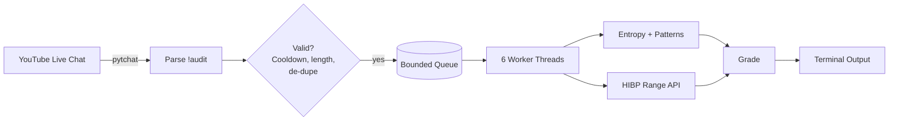

<div align="center">

# 🔐 Live Password Auditor

**Your chat types `!audit`. Your terminal answers in real time.**
A concurrent YouTube Live Chat bot that grades passphrases on entropy, patterns and known breaches.


<!-- Replace with a 10-15s terminal GIF of a live audit -->
<!--  -->

</div>

---

> [!WARNING]
> **Dummy passphrases only.** YouTube chat is public. Anything a viewer types there is visible to everyone. Never submit a real password.

## Demo

Viewer types in chat:

```text
!audit Password123
```

Your terminal shows (sample values are illustrative):

```text
=================================================================
VIEWER: Alice
Masked sample : P*********3
Entropy       : 65.5 bits
Crack estimate: 165 years
HIBP result   : 230,000 occurrences
Pattern flags : Common/keyboard pattern, Predictable suffix
Security grade: F-TIER (WEAK OR EXPOSED)
Worker        : Auditor_2
=================================================================
```

The viewer's full input is never printed. Only a masked sample is shown.

## Features

| | |
|---|---|
| ⚡ **Concurrent** | Thread pool of 6 workers, bounded queue of 50 |
| 🛡️ **Breach check** | Have I Been Pwned range API. Only the first 5 characters of the SHA-1 hash leave your machine |
| 🧠 **Pattern detection** | Keyboard runs, repeated characters, years, predictable suffixes |
| 📊 **Entropy and crack time** | Character-pool entropy with an illustrative offline-attack estimate |
| 🏅 **Tiered grading** | `S` strong · `A` good · `C` weak · `F` weak or exposed |
| 🚦 **Abuse protection** | Per-user cooldown, length cap, control-character rejection, message de-duplication |
| 🧹 **Privacy-minded** | No raw passwords in logs or error output. Results cached by hash, not plaintext |

## Quickstart

```bash
git clone https://github.com/zerotraceacademy/projects.git
cd projects/password-auditor   # adjust to your folder name
python -m pip install pytchat python-dotenv
```

Set your live stream's video ID (the part after `v=` in the URL).

**Option A: `.env` file** (recommended)

```env
YOUTUBE_VIDEO_ID=YOUR_VIDEO_ID
```

**Option B: environment variable**

```bash
# macOS / Linux
export YOUTUBE_VIDEO_ID=YOUR_VIDEO_ID

# Windows CMD
set YOUTUBE_VIDEO_ID=YOUR_VIDEO_ID
```

Run it:

```bash
python youtube_live_auditor.py
```

Then type `!audit DemoPass2026!` in the live chat.

## How it works



### Grading logic

| Tier | Condition |
|------|-----------|
| **F** | Found in a known breach **or** entropy below 40 bits |
| **C** | Entropy below 60 bits **or** 2+ pattern warnings |
| **A** | Entropy below 75 bits **or** 1 pattern warning |
| **S** | Everything else |

## Configuration

Edit the constants at the top of `youtube_live_auditor.py`:

| Setting | Default | Purpose |
|---------|---------|---------|
| `MAX_WORKERS` | `6` | Concurrent audit threads |
| `MAX_QUEUE_SIZE` | `50` | Pending audits before new ones are dropped |
| `MAX_PASSWORD_LENGTH` | `128` | Longest accepted input |
| `USER_COOLDOWN` | `5` | Seconds between requests per viewer |
| `HIBP_TIMEOUT` | `5` | Seconds before the breach check gives up |

## Privacy and limitations

Being upfront about what this is and isn't:

- **Chat is public.** Masking only protects your terminal and recordings of it. It cannot hide what the viewer already posted in chat.
- **k-anonymity.** The breach check sends only a 5-character hash prefix to HIBP, never the password or full hash.
- **Entropy is an estimate.** It multiplies length by the character-set size, so it overrates predictable passphrases and doesn't model dictionary attacks. Treat grades as educational, not as a security verdict.
- **Crack time is illustrative.** It assumes 10 billion guesses per second against a fast offline hash. Real attackers and real hashes vary widely.
- **`pytchat` is unofficial.** It reads chat without the official API, so it can break if YouTube changes things.
- **Breach check can fail.** If HIBP is unreachable, the result shows "API unavailable" and the grade falls back to entropy and patterns only.

## Troubleshooting

| Problem | Fix |
|---------|-----|
| `Install pytchat first` | `python -m pip install pytchat` |
| `ModuleNotFoundError: dotenv` | `python -m pip install python-dotenv` |
| `Set your YouTube Video ID first` | Set `YOUTUBE_VIDEO_ID` in `.env` or your shell |
| Connection error | Check the video ID, that the stream is live, and that chat is enabled |
| Garbled colors on Windows | Use Windows Terminal or a recent PowerShell |

## Ideas to extend

- Add a `!tips` command that returns generic hardening advice
- Swap the entropy model for [`zxcvbn`](https://github.com/dropbox/python-zxcvbn) for more realistic scoring
- Post results back to chat through the official YouTube Data API
- Add an on-stream leaderboard of strongest passphrases (dummy ones only)

---

<div align="center">

Built live on the **ZeroTrace Academy** stream.
If this taught you something, drop a ⭐

</div>
